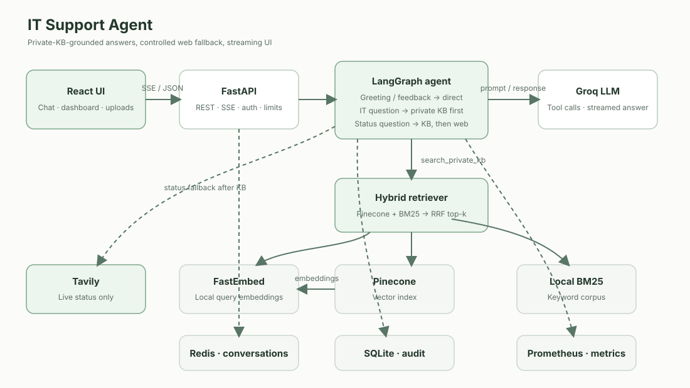

# IT Support Agent

RAG chatbot for employee IT support, grounded in a private knowledge base.

## Run

Requirements: Python 3.11+, uv, Node.js, npm, and Redis.

1. Install dependencies and create settings:

       uv sync --locked --group dev
       cp .env.example .env

   Add `GROQ_API_KEY` and `PINECONE_API_KEY` to `.env`, and start Redis.

2. Start the API:

       uv run --env-file .env uvicorn app.main:app --reload --host 127.0.0.1 --port 8080

3. In another terminal, start the UI:

       cd frontend
       npm ci
       npm run dev

Open http://127.0.0.1:5173. API docs: http://127.0.0.1:8080/docs.

The LangGraph agent handles chat and retrieval. `evals/cases.jsonl` contains the
40-case behavior and retrieval benchmark; run it with `uv run --env-file .env
python -m evals.run`.
