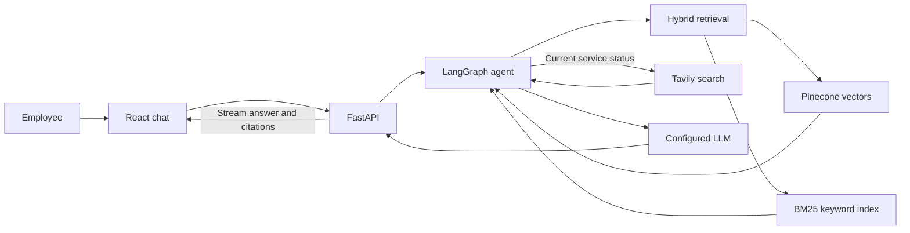

# IT Support Agent

An internal IT support chatbot grounded in a company knowledge base. Employees
can ask questions in a web chat, receive streamed answers with citations, and
upload support documents. The agent uses live web search for current service
status questions after checking the private knowledge base.

## Features

- **Knowledge-grounded answers:** Retrieves documents from Pinecone and a local
  BM25 index, then combines their rankings with reciprocal-rank fusion.
- **Tool-using agent:** A LangGraph workflow routes greetings and follow-ups,
  searches the private KB, and calls Tavily for current service status when
  needed. Groq is the default LLM; Gemini and OpenAI can be configured as
  fallbacks.
- **Streaming chat:** React UI streams answer text, citations, and agent trace
  events from FastAPI over server-sent events.
- **Document ingestion:** Supports PDF, TXT, Markdown, and DOCX. Ingestion can
  run inline or through a Redis-backed worker queue.
- **Conversation and operations:** Redis stores expiring conversation history;
  SQLite stores audit records. The admin dashboard shows usage, source
  breakdown, recent questions, and knowledge gaps. Prometheus metrics are
  available at `/metrics`.
- **Security controls:** Optional trusted-proxy authentication, admin-key
  protection for administrative operations, upload limits, rate limiting,
  production configuration checks, and PII redaction before public web search.
- **Evaluation:** A 40-case benchmark checks source and tool selection,
  citations, retrieval relevance, and latency. Reports include TTFT and
  generation speed when provider usage data is available.

## Workflow



For ordinary IT questions, the agent retrieves private KB evidence before
answering. Greetings and simple answer-feedback turns can skip retrieval. For
current service status, it checks the private KB and then searches the web.

## Project structure

```text
app/
  agent/       LangGraph workflow, prompts, policies, model setup, and tools
  api/         FastAPI routes, request schemas, authentication, and rate limits
  core/        Settings, logging, metrics, and privacy helpers
  rag/         Pinecone, BM25, hybrid retrieval, and reciprocal-rank fusion
  services/    Ingestion, conversations, audit records, and queue jobs
  main.py      FastAPI app, startup warm-up, health checks, and static UI
  worker.py    Background ingestion worker
  bulk_ingest.py  Batch document indexing command
  build_bm25.py   Local BM25 corpus builder
frontend/
  src/         React chat, dashboard, upload dialog, and API client
data/
  sample_kb/   Sample handbook, runbook, and Q&A documents
docs/          Architecture and project background documents
evals/         Evaluation cases, dataset tools, runner, and reports
tests/         Offline unit and API tests
compose.yaml   App, worker, and Redis services
Dockerfile     Frontend and backend production image build
```

## Run locally

Requirements: Python 3.11+, [uv](https://docs.astral.sh/uv/), Node.js 20+,
npm, and Redis.

1. Install dependencies and create the environment file:

       uv sync --locked --group dev
       cp .env.example .env

2. Set `GROQ_API_KEY` and `PINECONE_API_KEY` in `.env`. Start Redis locally or
   with Docker:

       docker compose up -d redis

3. Start the API from the repository root:

       uv run --env-file .env uvicorn app.main:app --reload --host 127.0.0.1 --port 8080

4. In another terminal, start the UI:

       cd frontend
       npm ci
       npm run dev

Open <http://127.0.0.1:5173>. FastAPI's interactive API documentation is at
<http://127.0.0.1:8080/docs>.

Tavily is optional and is used for live service-status search. See
`.env.example` for model fallbacks, authentication, ingestion, and deployment
settings. The app preloads its embedding model and attempts a retrieval warm-up
at startup.

## Knowledge base

The sample corpus is in `data/sample_kb/`. Preview parsing and chunking before
indexing:

    uv run --env-file .env python -m app.bulk_ingest data/sample_kb --dry-run

Index the documents in Pinecone and the local BM25 corpus:

    uv run --env-file .env python -m app.bulk_ingest data/sample_kb

You can also upload a document from the chat UI or use `POST /api/ingest` with
the admin key. Set `INGEST_MODE=queue` to use the background worker. To rebuild
the keyword index from the sample corpus:

    uv run --env-file .env python -m app.build_bm25

## API and operations

| Method | Endpoint | Purpose |
|---|---|---|
| `POST` | `/api/chat` | Non-streaming chat response |
| `POST` | `/api/chat/stream` | Stream answer, trace events, and citations |
| `GET` | `/api/conversations/{id}` | Restore conversation history |
| `POST` | `/api/ingest` | Upload and index a document |
| `GET` | `/api/ingest/jobs/{id}` | Check queued ingestion status |
| `GET` | `/api/health`, `/api/ready` | Liveness and readiness checks |
| `GET` | `/api/stats` | Admin dashboard data |
| `GET` | `/metrics` | Prometheus metrics |

Conversation history expires after 24 hours by default. In production,
configure a unique `ADMIN_API_KEY`, set `AUTH_MODE=proxy` behind a trusted SSO
proxy, restrict CORS, and keep Redis and `/metrics` on a private network.
Ingestion is disabled by default in production unless explicitly enabled.

## Evaluation and tests

Run the live benchmark against configured model and retrieval services:

    uv run --env-file .env python -m evals.run --repeats 3 --output evals/reports/run.json

Cases are in `evals/cases.jsonl`. The runner reports pass rate, source and tool
selection, retrieval scores, end-to-end latency percentiles, and per-call
TTFT/generation metrics. Reports under `evals/reports/` are gitignored.

Run the offline test suite (external retrieval and model services are mocked):

    uv run --locked --group dev pytest

Build and run the app, worker, and Redis with Docker Compose:

    docker compose up --build
