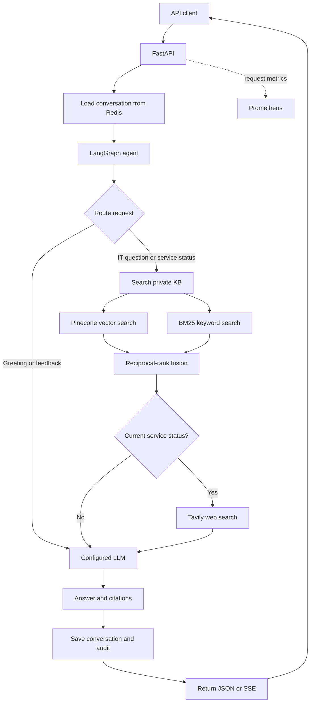
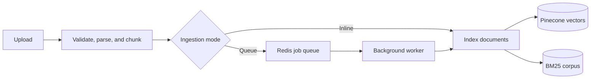

# IT Support Agent — Backend

An API service for employee IT support. It uses a tool-using LLM agent and a
private knowledge base to produce grounded answers with source citations. It
also supports current service-status lookup, document ingestion, conversation
memory, audit records, and operational metrics.

## Backend workflow



For IT questions, private retrieval runs before generation. Current service
status questions also use Tavily after the private KB lookup. Greetings and
simple answer-feedback turns skip retrieval.

### Document ingestion



The ingestion path builds the Pinecone and BM25 indexes used by the chat
workflow. The API can index uploads inline or place them on the Redis queue for
the worker.

## Capabilities

- **Hybrid RAG:** FastEmbed embeddings and Pinecone vector search run alongside
  local BM25 keyword search. Reciprocal-rank fusion combines the result lists.
- **Agent workflow:** LangGraph routes requests, handles follow-ups, executes
  private and web search tools, and returns citations and trace events.
- **Streaming and regular chat:** API clients can use either a normal JSON
  response or server-sent events for incremental output.
- **Ingestion:** PDF, TXT, Markdown, and DOCX files can be parsed, chunked, and
  indexed inline or through the Redis-backed worker queue. Markdown Q&A records
  retain their record IDs as citation metadata.
- **Conversation memory:** Redis stores a bounded recent message history with a
  configurable expiry.
- **Audit and operations:** SQLite stores request audit data. The stats API
  reports usage, sources, recent queries, and knowledge gaps; `/metrics`
  exposes Prometheus metrics, including request, retrieval, and LLM timings.
- **Security:** Optional trusted-proxy identity and role checks, admin-key
  protection, request rate limiting, upload size and content validation,
  production configuration checks, and PII redaction before web search.
- **Evaluation:** A 40-case live benchmark checks routing, tools, citations,
  retrieval relevance, and latency. It reports end-to-end percentiles and
  per-call TTFT/generation metrics when available.

## Repository structure

```text
app/
  agent/       LangGraph workflow, policy, prompts, tools, and LLM providers
  api/         FastAPI routes, schemas, auth dependencies, and rate limits
  core/        Settings, logging, metrics, and privacy helpers
  rag/         Pinecone, BM25, and hybrid retrieval
  services/    Ingestion, queue jobs, conversation memory, and audit storage
  main.py      FastAPI application and startup initialization
  worker.py    Redis-backed ingestion worker
  bulk_ingest.py  Batch indexing command
  build_bm25.py   BM25 corpus builder
data/
  sample_kb/   Sample IT handbook, runbook, and Q&A records
docs/          Architecture and project background
evals/         Benchmark cases, dataset tools, runner, and reports
tests/         Unit and API tests
compose.yaml   API, worker, and Redis services
Dockerfile     Production container build
```

## Configuration

Python 3.11+ and Redis are required. Copy `.env.example` to `.env` and configure
the services you use:

| Setting | Required for | Notes |
|---|---|---|
| `GROQ_API_KEY` | Default chat model | Gemini or OpenAI keys can be used as fallback providers. |
| `PINECONE_API_KEY` | Private vector retrieval | Set the index name and namespace if needed. |
| `REDIS_URL` | Conversation memory and queued ingestion | Defaults to local Redis. |
| `TAVILY_API_KEY` | Live service-status web search | Optional for private-KB-only use. |

Other settings cover model names, embedding model, retrieval `TOP_K`, request
limits, authentication, upload size, conversation expiry, and ingestion mode.
See `.env.example` for defaults and comments.

## Run locally

From the repository root:

    uv sync --locked --group dev
    cp .env.example .env

Set `GROQ_API_KEY` and `PINECONE_API_KEY` in `.env`. Start Redis with Docker
Compose (or use an existing Redis instance):

    docker compose up -d redis

Then run the API:

    uv run --env-file .env uvicorn app.main:app --reload --host 127.0.0.1 --port 8080

The API documentation is available at <http://127.0.0.1:8080/docs>. Startup
loads the embedding model and performs a best-effort retrieval warm-up.

## Knowledge-base ingestion

Preview the bundled documents without writing to the indexes:

    uv run --env-file .env python -m app.bulk_ingest data/sample_kb --dry-run

Index the documents into Pinecone and BM25:

    uv run --env-file .env python -m app.bulk_ingest data/sample_kb

To rebuild the local BM25 corpus from the sample knowledge base:

    uv run --env-file .env python -m app.build_bm25

The API also provides `POST /api/ingest` for one document and
`GET /api/ingest/jobs/{id}` for queued-job status. Set `INGEST_MODE=queue` to
process uploads with the worker. Ingestion is disabled by default in production
unless explicitly enabled.

## API and operations

| Method | Endpoint | Purpose |
|---|---|---|
| `POST` | `/api/chat` | JSON chat response |
| `POST` | `/api/chat/stream` | Stream response tokens, traces, and final citations |
| `GET` | `/api/conversations/{id}` | Restore recent conversation history |
| `POST` | `/api/ingest` | Upload and index a document |
| `GET` | `/api/ingest/jobs/{id}` | Get queued ingestion status |
| `GET` | `/api/health` | Liveness check |
| `GET` | `/api/ready` | Redis and local BM25 readiness |
| `GET` | `/api/stats` | Admin audit and knowledge-gap data |
| `GET` | `/metrics` | Prometheus metrics |

Production deployments require a unique `ADMIN_API_KEY`, `AUTH_MODE=proxy`
behind a trusted identity proxy, restricted CORS origins, and private access to
Redis and `/metrics`. Conversation history expires after 24 hours by default.

## Evaluation and tests

Run the live benchmark against the configured LLM and retrieval services:

    uv run --env-file .env python -m evals.run --repeats 3 --output evals/reports/run.json

Cases are defined in `evals/cases.jsonl`. The report includes pass rate, source
and tool selection, retrieval scores, latency percentiles, TTFT, generation
time, and token throughput when provider usage is returned. Evaluation reports
are gitignored.

Run the offline tests:

    uv run --locked --group dev pytest

The test suite mocks external retrieval and model calls; it does not need live
LLM or Pinecone credentials.

## Docker Compose

Build and start the API, ingestion worker, and Redis:

    docker compose up --build

Compose expects a configured `.env` file. The worker is enabled with queued
ingestion mode.
