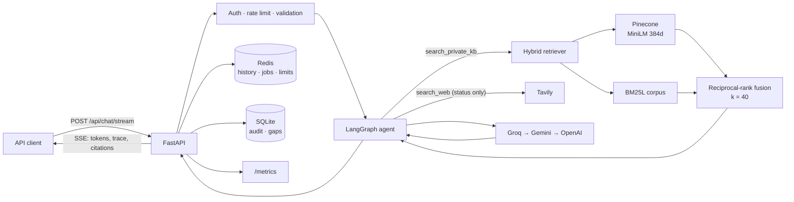
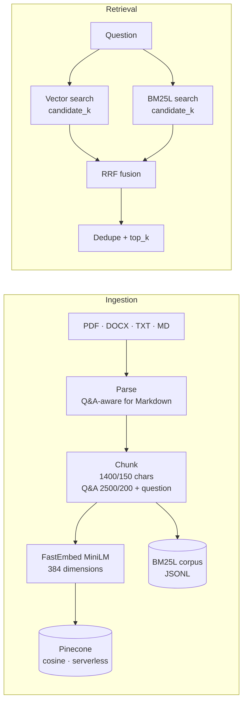
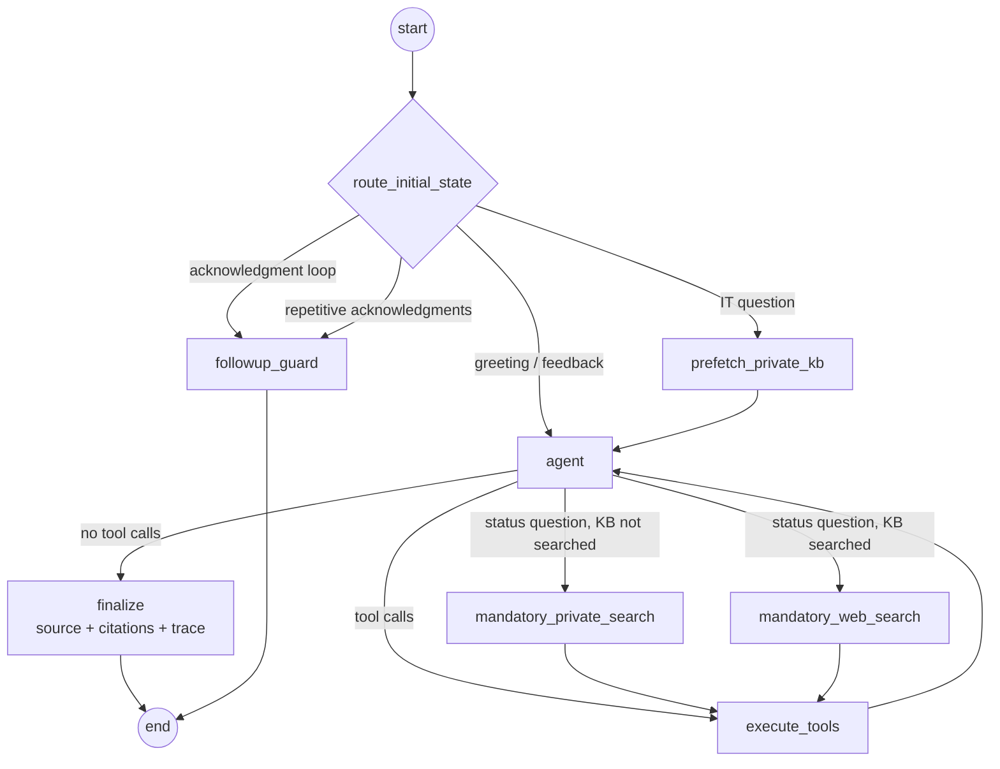

# Enterprise IT Support — Agentic RAG Copilot

A backend service for internal IT support. It answers employee questions from a
private knowledge base, cites the chunks it used, streams tokens while it works,
and falls back to live web search only for current service-status questions.

The interesting part is not the chat endpoint — it is the retrieval and routing
layer: a hybrid retriever (Pinecone vectors + BM25 keywords fused with
reciprocal-rank fusion), a LangGraph tool loop that is forced to check the
private KB before the public web, and ingestion that keeps both indexes in sync.

## What it does

- **Grounded answers, not guesses.** Every IT question is retrieved against the
  private KB before the model answers; answers carry chunk-level citations.
- **Hybrid retrieval.** Dense Pinecone search and a local BM25L corpus are
  merged with reciprocal-rank fusion, so exact policy terms and paraphrased
  questions both hit.
- **Controlled tool use.** A LangGraph workflow decides when retrieval is
  skipped (greetings, answer feedback), when it is mandatory (outage questions),
  and caps the loop at 6 tool calls.
- **Provider failover.** Groq is primary; Gemini and OpenAI are tried in order
  when configured. Streaming never retries after output has started, so users
  do not receive duplicated text.
- **Ops built in.** Redis conversation memory, Redis-backed ingestion queue,
  SQLite audit trail with knowledge-gap detection, Prometheus metrics, rate
  limiting, PII redaction before web search, and production config guards.

## Architecture



The backend owns the whole request path. A client only needs to POST a question
and read the server-sent event stream; there is no server-side session state
outside Redis.

## The RAG pipeline

### 1. Ingestion: one chunk identity, two indexes



Every chunk gets a stable key derived from its source and byte offset
(`source#start_index`). That key is what lets the vector index and the BM25
corpus describe the same chunk, which makes fusion meaningful instead of a
comparison of two unrelated result sets.

- **Parsing.** Markdown in the IT Q&A format is split into one document per
  record (`## IT-12345` with `### Question` / `### Answer`), preserving record
  id, category, dataset source, and the original line offset. Everything else
  uses the PDF, DOCX, or plain-text loaders.
- **Chunking.** Regular documents split at 1400 characters with 150 overlap.
  Q&A records use a larger 2500/200 window so a full answer usually stays
  intact; when a record is split, the question is repeated in each piece so
  later chunks remain retrievable on their own.
- **Embedding.** FastEmbed runs the MiniLM ONNX weights locally — no embedding
  API key and a smaller memory footprint than the PyTorch equivalent. The
  model is preloaded at startup and baked into the Docker image.
- **Vector store.** Pinecone serverless, cosine metric. The index is created on
  demand, and a dimension mismatch raises instead of deleting a live index.

### 2. Retrieval: dense + sparse, fused once

```text
query ──► Pinecone top candidate_k ─┐
                                    ├─► dedupe by content ─► RRF ─► top_k
query ──► BM25L top candidate_k ────┘
```

- `candidate_k = max(top_k * 2, 10)` per retriever.
- Reciprocal-rank fusion scores each chunk as `1 / (40 + rank)` summed across
  rankings. Rank position matters, not raw scores, so dense and sparse scores
  never need to be calibrated against each other.
- BM25 uses **BM25L**, chosen because small corpora can make BM25Okapi assign
  every document a zero IDF and return nothing.
- Chunks are deduplicated by content hash before fusion and again after, so a
  file indexed under two paths cannot fill the top-k window twice.
- If the BM25 corpus is empty, retrieval degrades to vector-only with a warning
  instead of failing the request.

### 3. Keeping the indexes consistent

Ingestion is an upsert of a whole source, not an append:

1. New chunks are embedded and written with a fresh `ingestion_id`.
2. Previous vectors for that source are deleted with a Pinecone metadata filter
   that excludes the new `ingestion_id`.
3. If that delete fails, the new vectors are rolled back by id and the error is
   raised — a failed re-ingest leaves the old version serving.
4. BM25 source records are replaced, and the in-process corpus reloads when the
   file mtime changes, so a worker's write is visible to the API process.

The BM25 corpus is a deployment artifact, not source control content: the
Docker build regenerates it from `data/sample_kb/`.

## Agent workflow



Design decisions worth knowing:

- **Deterministic prefetch.** For a normal IT question the graph runs
  `search_private_kb` before the model speaks, saving one model round-trip that
  would otherwise only produce a tool call.
- **Mandatory evidence order.** A current-status question ("is VPN down?") is
  forced through private KB first and web second. The model cannot skip ahead to
  the public web, and `search_web` is only exposed after the private search.
- **Non-retrieval turns.** Greetings, acknowledgments, and answer-quality
  feedback skip retrieval; a follow-up like "where did that come from?" reuses
  the previous substantive question as its search query.
- **Tool budget.** At most 6 tool calls. When the budget is exhausted or the
  model requests an unavailable tool, `finalize` answers from the results that
  already exist rather than failing the request.
- **Loop guard.** Repeated acknowledgment-only turns are answered directly
  instead of triggering another model round.
- **Failover semantics.** Providers are tried in configuration order. A stream
  that fails after its first token raises instead of retrying, preventing a
  half-answer from being replayed on top of itself.

The model sees one system prompt covering scope, evidence rules, prompt-injection
resistance, secret handling, and response style. Tool output is treated as
untrusted data, not instructions.

## Backend layout

```text
app/
  agent/
    graph.py        LangGraph composition and initial state
    nodes.py        routing, prefetch, mandatory steps, tools, finalize
    policy.py       regex policies for greetings, feedback, status questions
    tools.py        search_private_kb and search_web tools
    model.py        provider construction, failover, streaming, token metrics
    prompts.py      system prompt and guardrails
    state.py        agent state schema
  api/
    routes.py       chat, SSE stream, conversations, ingest, stats, health
    deps.py         admin auth, proxy identity, rate limit, ingestion guard
    schemas.py      request/response models and token limits
  rag/
    hybrid.py       chunk keys, dedupe, BM25L index, RRF, HybridRetriever
    vectorstore.py  Pinecone setup, embeddings, index reload, replace semantics
    workflow.py     compatibility exports
  services/
    ingestion.py    parsing, chunking, index_file
    ingest_jobs.py  Redis queue, leases, retries, job status
    conversation.py Redis history with owner scoping and TTL
    audit.py        SQLite audit, source breakdown, knowledge gaps
  core/
    config.py       settings and production validation
    metrics.py      Prometheus counters and histograms
    privacy.py      regex PII redaction before web search
    logging.py      log configuration
  main.py           app lifecycle, warm-up, request middleware, metrics
  worker.py         background ingestion worker
  bulk_ingest.py    directory ingestion CLI
  build_bm25.py     BM25 corpus builder
data/sample_kb/     sample handbook, runbook, and 10 Q&A documents
evals/              evaluation cases, runner, reports
tests/              offline unit and API tests
```

## Run it locally

Requirements: Python 3.11+ and [uv](https://docs.astral.sh/uv/). Redis is
required for chat history; Pinecone and one model provider are required for
real answers.

```bash
uv sync --locked --group dev
cp .env.example .env
# set GROQ_API_KEY and PINECONE_API_KEY in .env
docker compose up -d redis

uv run --env-file .env uvicorn app.main:app --reload --host 127.0.0.1 --port 8080
```

Interactive API docs: <http://127.0.0.1:8080/docs>.

```bash
curl -N -X POST http://127.0.0.1:8080/api/chat/stream \
  -H 'Content-Type: application/json' \
  -d '{"question": "How do I request VPN access?"}'
```

Tavily is optional and only used for live service-status questions. See
`.env.example` for provider fallbacks, auth, ingestion, and deployment settings.
Startup preloads the embedding model and warms the retrieval path; a failed
warm-up is logged and does not block the app.

## Load the knowledge base

Preview parsing and chunking without writing anything:

```bash
uv run --env-file .env python -m app.bulk_ingest data/sample_kb --dry-run
```

Index into Pinecone and the BM25 corpus:

```bash
uv run --env-file .env python -m app.bulk_ingest data/sample_kb
```

Rebuild only the keyword corpus (no embedding model required):

```bash
uv run --env-file .env python -m app.build_bm25
```

Uploads go through `POST /api/ingest` with the admin key. Set
`INGEST_MODE=queue` to hand indexing to `app.worker` through Redis instead of
doing it in the request.

## API

| Method | Endpoint | Purpose |
|---|---|---|
| `POST` | `/api/chat` | Non-streaming answer with trace and citations |
| `POST` | `/api/chat/stream` | SSE stream: `token`, `trace`, `done`, `error` |
| `GET` | `/api/conversations/{id}` | Restore history (owner-scoped in proxy mode) |
| `POST` | `/api/ingest` | Upload and index a document (admin) |
| `GET` | `/api/ingest/jobs/{id}` | Queued ingestion status |
| `GET` | `/api/health` | Liveness |
| `GET` | `/api/ready` | Redis and BM25 readiness |
| `GET` | `/api/stats` | Usage, sources, gaps, recent questions (admin) |
| `GET` | `/metrics` | Prometheus exposition |

Chat responses include `source_used` (`direct`, `private_kb`, or `web_search`),
the full agent trace, citations, and the query actually used for retrieval.
Streaming emits trace lines as graph nodes complete, so a client can show
"searching the KB" before the first token arrives.

## Security and operations

- **Admin access.** `X-Admin-Key` must match `ADMIN_API_KEY`, or in proxy mode
  the user must carry one of `AUTH_ADMIN_ROLES`. Comparisons are constant-time.
- **Identity.** With `AUTH_MODE=proxy`, the trusted reverse proxy supplies the
  user header; history keys are scoped per user. `AUTH_MODE=none` is local-only.
- **Rate limiting.** Sliding one-minute window in Redis per user (or client IP
  without auth). Redis outages fail open so chat stays available.
- **Uploads.** Extension allow-list, content-signature checks (PDF header, DOCX
  zip structure, UTF-8 text), a 25 MB cap, generated filenames on disk, and
  ingestion disabled in production unless `ALLOW_INGESTION=true`.
- **Privacy.** PII and secret patterns are redacted before any web search; the
  system prompt also forbids sending employee-specific details off-host.
- **Production guards.** Startup refuses a default admin key, wildcard CORS, or
  `AUTH_MODE=none` when `APP_ENV=production`.
- **Data retention.** Conversation history keeps the last 20 messages for 24
  hours by default. SQLite audit records persist; knowledge gaps are derived
  from web-sourced answers and the explicit "not documented" phrase.

## Observability

Prometheus metrics cover HTTP latency and status, chat outcomes by evidence
source, ingestion outcomes, rate-limit rejections, retrieval latency, and LLM
calls by provider and mode — including time to first token, generation time,
output tokens, and tokens per second when the provider reports usage.

Structured logs carry a request id (or conversation id) through retrieval, tool
calls, LLM timing, ingestion jobs, and queue retries. `X-Request-ID` is accepted
from callers and echoed back; responses also set `nosniff`, `DENY` framing, and
a strict referrer policy.

Metrics are per-process. For multiple API workers, enable Prometheus
multiprocess mode rather than aggregating by hand.

## Evaluation and tests

Run the live benchmark (40 cases; requires configured model and retrieval
services):

```bash
uv run --env-file .env python -m evals.run --repeats 3 --output evals/reports/run.json
```

The runner checks source and tool selection, citation presence, retrieval
relevance, and latency percentiles, and records per-call TTFT and generation
speed. Reports under `evals/reports/` are gitignored.

Run the offline suite (external services mocked):

```bash
uv run --locked --group dev pytest
```

CI runs the same suite on Python 3.11 and 3.14.

## Deploy

```bash
docker compose up --build
```

Compose runs three services: the API, the ingestion worker, and Redis. The image
builds the embedding model and BM25 corpus into the image, runs as a non-root
user, and uses `/api/ready` as its health check. For production, mount durable
storage for `data/` and `uploads/`, keep Redis and `/metrics` on a private
network, and terminate SSO at a trusted proxy.
